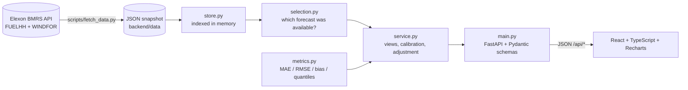

# WindSight: day-ahead wind forecast monitor

WindSight is a web app for a UK utility's **day-ahead power procurement team**. For each delivery day it shows
the national wind forecast that was available when the purchase decision had to be made. It also measures how
accurate that forecast turned out to be, so buyers can size their purchases with a known margin of error.

- **Live app:** _<add your Vercel URL here>_
- **Video walkthrough:** _<add your unlisted YouTube URL here>_
- **Scope:** purchase decisions made in January 2026, so delivery days run from 2 Jan to 1 Feb 2026. The data is
  national wind generation from Elexon BMRS (`FUELHH` actuals and `WINDFOR` forecasts).

---

## What the app does

| View | Question it answers |
|---|---|
| **Day-ahead view** | "When I placed bids for day D, what did the wind forecast say, how sure could I be, and what actually happened?" Shows the forecast run in force at the decision time, a bias-adjusted forecast, an 80% uncertainty band, a *firm wind* volume at 90% confidence, the actual outturn and a CSV export. |
| **Forecast accuracy** | "How far can I trust the day-ahead forecast?" Shows MAE/RMSE/bias/WAPE over the month, a planning-buffer table (how much to hold back for 50/80/90/95% cover), daily errors (click a day to drill in), error against lead time, error against wind level, the error distribution, a forecast-vs-actual scatter, and error by hour of day. |
| **Methodology** | The exact rules behind every number, in plain English. |

The **decision time** (D-1, UK local time) is a global control in the header. The default is 09:00, just before the
GB day-ahead auctions close (EPEX 09:20, N2EX 09:50). Changing it re-runs the whole analysis against the forecast
runs that would have been available at that time. Every view is a shareable URL, for example
`#day?date=2026-01-28&t=09:00`.

### Key findings (January 2026, 09:00 decision time, 744 delivery hours)

- **The Elexon day-ahead forecast over-forecast wind by 1.75 GW on average** (+15% of actual output). A buyer
  relying on it unadjusted was structurally short.
- **Subtracting the previous two weeks' average error**, using only data available at decision time, cuts the
  typical hourly error (MAE) **from 2.02 GW to 1.49 GW (−26%)**. RMSE falls from 2.50 to 1.95 GW.
- **To cover wind shortfall in 90% of hours, hold back about 4.15 GW** (32% of the average forecast) from the raw
  forecast.
- Error grows with lead time, from 1.68 GW MAE at 0 h to 2.23 GW at 43 h. Day-ahead decisions are made at 16.5–39.5 h.
- Over-forecasting grows with wind level: about +4.5 GW when the forecast is 20–24 GW. This fits wind curtailment and
  high-wind turbine cut-out, but is not yet confirmed against constraint data. The worst day was **28 Jan**: forecast
  267 GWh, actual 139 GWh.

---

## Quick start

### Option A: Docker (one command)

```bash
docker compose up --build
# open http://localhost:8000          (UI)
# open http://localhost:8000/docs     (interactive API docs)
```

### Option B: local development

Prerequisites: Python 3.12+ and Node 20+.

```bash
# Backend (terminal 1)
cd backend
python -m venv .venv
.venv/bin/pip install -r requirements-dev.txt        # Windows: .venv\Scripts\pip
.venv/bin/uvicorn app.main:app --reload --port 8000

# Frontend (terminal 2), proxies /api to :8000
cd frontend
npm ci
npm run dev                                           # http://localhost:5173
```

### Tests and linting

```bash
cd backend && .venv/bin/pytest && .venv/bin/ruff check . && .venv/bin/ruff format --check .
cd frontend && npm run lint && npm run build          # build includes the TypeScript type-check
```

CI (`.github/workflows/ci.yml`) runs all of the above plus a Docker build on every push.

### Refreshing the data snapshot

```bash
cd backend && .venv/bin/python -m scripts.fetch_data
```

---

## Deployment

**Vercel** (the live app) uses [Vercel Services](https://vercel.com/docs/services): one project, one domain,
with two independently built services defined in `vercel.json`:

| Service | Root | Public paths |
|---|---|---|
| `backend` (FastAPI, `app.main:app`) | `backend/` | `/api/*`, `/docs`, `/openapi.json` |
| `frontend` (Vite static build) | `frontend/` | everything else |

The browser calls the API on the same origin (`/api/...`), so there are no service-to-service bindings and no CORS
setup. Vercel passes the original path to the backend, so routes are identical in Docker, local development and
Vercel. To deploy, import the GitHub repo at vercel.com/new and click Deploy; every push to `main` redeploys
automatically. To run the same routing locally, use `vercel dev -L`.

**Heroku** (alternative): the Dockerfile reads `$PORT`, so the same image runs unchanged:
`heroku container:push web && heroku container:release web`.

---

## Architecture



| Layer | Responsibility | Notes |
|---|---|---|
| `backend/app/elexon.py` | HTTP client for the two BMRS stream endpoints | Requests are chunked by week and retried |
| `backend/scripts/fetch_data.py` | Builds the committed snapshot | De-duplicates on (publishTime, startTime) |
| `backend/app/store.py` | Loads the snapshot into indexed structures | Loaded once and cached per process |
| `backend/app/selection.py` | **Core domain rule:** latest forecast published at or before a cutoff, excluding back-casts | Handles UK time, including 23- and 25-hour clock-change days |
| `backend/app/metrics.py` | Error statistics | Pure Python, numpy-compatible quantiles |
| `backend/app/service.py` | Assembles each API view; trailing-window calibration and bias adjustment | `lru_cache`, since inputs are immutable |
| `backend/app/schemas.py` | Pydantic response models | Self-documenting OpenAPI at `/docs` |
| `backend/app/main.py` | Routes, validation, gzip; serves the SPA in Docker | |
| `frontend/src/api.ts` | Typed client and a `useApi` hook with abort-on-change | Types mirror `schemas.py` |
| `frontend/src/views/*` | Day-ahead, Accuracy and Methodology views | URL-hash routing, so views are shareable |

### API

| Endpoint | Description |
|---|---|
| `GET /api/meta` | Window, defaults, data provenance |
| `GET /api/day?date=YYYY-MM-DD&decision_time=HH:MM` | Half-hourly actuals, the hourly forecast in force, adjusted forecast, P10–P90 band, day stats |
| `GET /api/accuracy?decision_time=HH:MM` | Month-level stats, daily table, breakdowns, histogram, scatter, buffers |
| `GET /api/horizons` | Error against lead time (0–43 h) |
| `GET /api/health` | Liveness |

### Key design decisions

1. **No look-ahead anywhere.** A forecast counts only if `publishTime ≤ decision cutoff` (D-1 at the chosen UK
   time). The bias adjustment and uncertainty band for day D use only delivery days D-15 to D-2. Their outturn was
   complete before the D-1 decision, and a test enforces this. The snapshot therefore starts in mid-December to
   calibrate the first January days.
2. **Back-casts are excluded.** Each WINDFOR run also reports values for up to 25 h *before* it was published.
   They are not forecasts, so `latest_forecast` caps the cutoff below the target time.
3. **Fallback to an older run.** If the newest eligible run does not cover a target hour, the latest run that does
   is used.
4. **A constant sample for the lead-time curve.** WINDFOR runs stop at a fixed time of day and reach 46–66 h.
   Beyond about 43 h, some overnight hours have no forecast at all. The curve stops there rather than mix samples.
5. **Matching on the forecast's hourly timestamp.** Hourly forecasts are compared with the half-hourly actual that
   starts at the same time. No values are interpolated.
6. **Snapshot over live calls.** January 2026 is historical. A committed snapshot (about 1.5 MB) makes the app fast,
   deterministic, testable and independent of the upstream API. The fetch script regenerates it. A live data
   source would be a swap of `store.load()`.
7. **No pandas or numpy at runtime.** About 30k rows don't need them. Leaving them out keeps the Vercel function
   small and cold starts fast.
8. **Error sign = forecast − actual.** A positive error means less wind than forecast, which is a shortfall for
   the buyer. The convention is the same everywhere, including the UI copy.

### Assumptions and limitations

- "Actual" is Elexon `FUELHH` WIND, which covers transmission-metered wind. Embedded (distribution-connected) wind
  is not in either dataset.
- The uncertainty band is empirical and short-window (14 days). It reacts quickly but is noisy after unusual days.
  The planning-buffer table is an in-sample January back-test and is labelled as such.
- The data is national level only, per the brief. There is no demand or price data, so the app reports wind volumes
  and risk rather than a final purchase volume.

### Possible next steps

- Live mode: poll WINDFOR and FUELHH and show today's decision in real time.
- Make the correction depend on wind level, since bias grows with the forecast level, and evaluate it with proper
  rolling-origin cross-validation.
- Join constraint and curtailment data (BOALF) to explain the over-forecasting.
- Add demand forecasts to turn "firm wind" into a recommended day-ahead purchase volume.

---

## Repository layout

```
.
├── backend/
│   ├── app/
│   │   ├── config.py            # analysis window, decision-time default, paths
│   │   ├── elexon.py            # BMRS API client
│   │   ├── store.py             # snapshot loading and indexing
│   │   ├── selection.py         # which forecast was available at decision time
│   │   ├── metrics.py           # error statistics
│   │   ├── service.py           # view assembly, calibration, bias adjustment
│   │   ├── schemas.py           # Pydantic response models
│   │   └── main.py              # FastAPI routes
│   ├── data/                    # committed Elexon snapshot (actuals.json, forecasts.json)
│   ├── scripts/fetch_data.py    # regenerates the snapshot
│   ├── tests/                   # pytest: selection rules, metrics, API end-to-end
│   ├── requirements.txt         # runtime dependencies
│   ├── requirements-dev.txt     # adds pytest and ruff
│   ├── pytest.ini, ruff.toml    # test and lint config
├── frontend/
│   ├── src/
│   │   ├── api.ts               # typed API client and data hook
│   │   ├── format.ts            # UK-time and GW/GWh formatting
│   │   ├── theme.ts             # chart palette
│   │   ├── components/ui.tsx    # Card, Kpi, Legend, Status
│   │   ├── views/               # DayView, AccuracyView, MethodView
│   │   └── App.tsx              # shell, tabs, decision-time control, URL routing
│   └── vite.config.ts           # dev proxy and chunking
├── Dockerfile                   # multi-stage: build UI → Python runtime serving UI and API
├── docker-compose.yml
├── vercel.json                  # Vercel Services: frontend and backend, plus public routing
└── .github/workflows/ci.yml     # lint, test, build and Docker build
```

---

## Use of AI tools

This project was built with help from an AI coding assistant (Claude Code by Anthropic). I used it for scaffolding,
writing code and tests, and drafting documentation. I directed the domain decisions: the decision-time semantics,
the no-look-ahead calibration, excluding back-casts, and the choice of metrics. I reviewed the code and checked the
outputs against the raw Elexon data.
